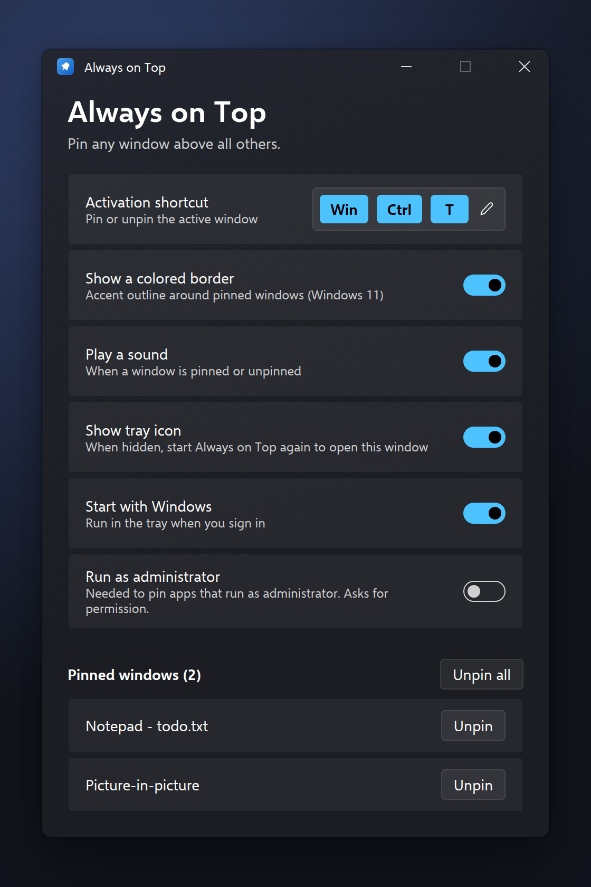
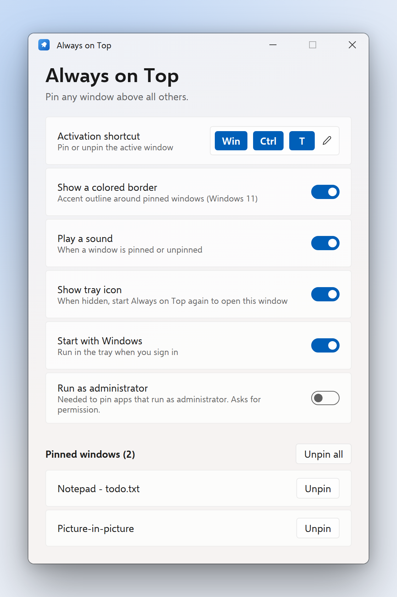

<p align="center">
  
</p>

<h1 align="center">Always on Top</h1>

<p align="center">
  Pin any window above all others with <kbd>Win</kbd> + <kbd>Ctrl</kbd> + <kbd>T</kbd>.<br>
  The PowerToys feature on its own, as one small native exe.
</p>

<p align="center">
  <a href="https://github.com/marioparaschiv/always-on-top/releases/latest/download/always-on-top.exe"><b>Download for Windows</b></a>
</p>

<p align="center">
  
  
</p>

## Why

PowerToys Always on Top is great, but you have to install all of PowerToys to get it: dozens of tools, a runner and a settings app, all running in the background. This is just the one feature, written in Rust.

- **Extremely lightweight.** One ~1.3 MB exe. It needs no .NET runtime or WebView, and there's no installer to run.
- **Stays small in the background.** The tray process uses plain Win32 calls only. The WinUI 3 settings window is a separate process that exits when you close it, so WinUI's memory is only used while it's open.
- **Looks like PowerToys.** The settings window is real WinUI 3, with Mica, Fluent controls and light and dark themes.

## Features

- <kbd>Win</kbd> + <kbd>Ctrl</kbd> + <kbd>T</kbd> pins or unpins the focused window. Click the shortcut in settings to record a different one.
- An accent-colored border marks pinned windows on Windows 11, and a sound plays when you pin or unpin.
- The settings window lists pinned windows. Unpin them one by one or all at once.
- **Show tray icon** can hide the tray icon. To open settings when it's hidden, start the app again.
- **Start with Windows** starts it in the background when you sign in.
- **Run as administrator** (off by default, as in PowerToys) lets you pin apps that run as administrator.

## Install

1. Download [`always-on-top.exe`](https://github.com/marioparaschiv/always-on-top/releases/latest/download/always-on-top.exe).
2. Run it.

It moves itself to `%LOCALAPPDATA%\Programs\AlwaysOnTop`, adds **Always On Top** shortcuts to the desktop and Start menu, and shows a dialog when it's done. To update, run a newer exe the same way. It replaces the installed copy.

Needs Windows 10 or 11 and the [Windows App Runtime](https://learn.microsoft.com/windows/apps/windows-app-sdk/downloads) 1.3 or newer for the settings window. Many Windows 11 PCs already have it.

## How it works

| | |
| --- | --- |
| Tray process | Default launch. Owns the hotkey, the pinned windows and the tray icon. Pure Win32. |
| Settings process | `--settings`. The WinUI 3 window. Talks to the tray through window messages. |
| Settings | `HKCU\Software\AlwaysOnTopRs` |
| Start with Windows | `HKCU\...\CurrentVersion\Run` value `AlwaysOnTopRs`, or a scheduled task `AlwaysOnTopRs` (highest privileges) in admin mode |
| Install folder | `%LOCALAPPDATA%\Programs\AlwaysOnTop` |

Pinning sets `HWND_TOPMOST`. The border uses the DWM border color, like PowerToys. In admin mode the tray restarts elevated through UAC, because Windows blocks a normal process from changing elevated windows.

## Build

```sh
cargo build --release                                    # on Windows
cargo build --release --target x86_64-pc-windows-gnu     # cross from Linux (mingw-w64)
```

| File | Role |
| --- | --- |
| `src/tray.rs` | Tray process: hotkey, tray icon, timer, IPC messages |
| `src/state.rs`, `src/pin.rs` | Pinning logic |
| `src/gui.rs`, `src/ui.rs`, `src/markup.rs` | Settings process, its XAML page and handlers |
| `src/recorder.rs`, `src/shortcut.rs` | Shortcut dialog (keyboard hook) and shortcut model |
| `src/xaml_app.rs`, `src/runtime.rs` | The `Application` subclass and Windows App SDK bootstrap |
| `src/elevation.rs`, `src/autostart.rs`, `src/install.rs` | Admin mode, sign-in start, self-install |
| `src/bindings.rs` | Generated WinUI 3 projection, do not edit |

### Regenerating the WinUI bindings

Only needed when `src/ui.rs` uses a WinUI type that is missing. Add it to `tools/bindgen/filter.txt`, then:

```sh
for pkg in microsoft.windowsappsdk.winui/2.3.9 microsoft.windowsappsdk.interactiveexperiences/2.1.9 \
           microsoft.windowsappsdk.foundation/2.3.12 microsoft.web.webview2/1.0.2151.40; do
  name="${pkg%/*}"; ver="${pkg#*/}"
  curl -sSLO "https://api.nuget.org/v3-flatcontainer/$name/$ver/$name.$ver.nupkg"
  unzip -qo -j "$name.$ver.nupkg" 'metadata/*.winmd' 'metadata/10.0.18362.0/*.winmd' 'lib/*.winmd' -x 'metadata/10.0.17763.0/*' -d winmd
done
cargo run --manifest-path tools/bindgen/Cargo.toml -- winmd
```

Base classes are not pulled in automatically. If the build says `cannot find type Foo`, add `Foo` to the filter too.

## Credits

- Inspired by [PowerToys Always on Top](https://learn.microsoft.com/windows/powertoys/always-on-top) by Microsoft.
- The icon is the Nucleo Micro Bold `pin-tack-filled` glyph on a blue rounded square (`assets/icon.svg`, rendered to `assets/icon.ico`).
